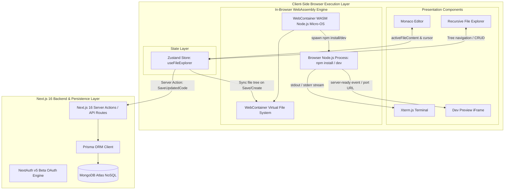
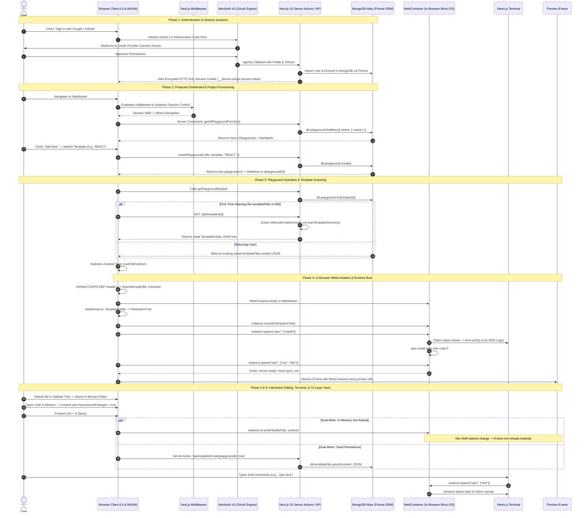

# Vibe Editor: Master Architecture & Technical Interview Defense Guide

A comprehensive, production-grade guide covering the complete architecture, component interactions, security model, database rationale, edge cases, and interview defense strategies for **Vibe Editor**.

---

## Table of Contents
1. [Project Overview & Problem Statement](#1-project-overview--problem-statement)
2. [Why We Built Vibe Editor](#2-why-we-built-vibe-editor)
3. [Technology Stack & Architectural Rationale](#3-technology-stack--architectural-rationale)
4. [High-Level Architecture & System Topology](#4-high-level-architecture--system-topology)
5. [End-to-End System Lifecycle (Login to Live Preview)](#5-end-to-end-system-lifecycle-login-to-live-preview)
   - [Phase 1: Authentication & Secure Session Issuance](#phase-1-authentication--secure-session-issuance)
   - [Phase 2: Route Protection & Project Provisioning](#phase-2-route-protection--project-provisioning)
   - [Phase 3: Workspace Hydration & Template Scanning](#phase-3-workspace-hydration--template-scanning)
   - [Phase 4: WebContainer Boot & Virtual File System Mount](#phase-4-webcontainer-boot--virtual-file-system-mount)
   - [Phase 5: Dependency Installation & Dev Server Execution](#phase-5-dependency-installation--dev-server-execution)
   - [Phase 6: Live Editing & Tri-Layer Synchronization](#phase-6-live-editing--tri-layer-synchronization)
   - [Phase 7: Interactive Terminal Streaming](#phase-7-interactive-terminal-streaming)
6. [Database Architecture & Why MongoDB](#6-database-architecture--why-mongodb)
7. [Critical Edge Cases & Real-World Engineering](#7-critical-edge-cases--real-world-engineering)
8. [Comprehensive Interview Defense Q&A](#8-comprehensive-interview-defense-qa)
   - [Q1: What was your individual contribution?](#q1-what-was-your-individual-contribution)
   - [Q2: What was the hardest problem you solved?](#q2-what-was-the-hardest-problem-you-solved)
   - [Q3: What bugs and challenges did you face, and how did you solve them?](#q3-what-bugs-and-challenges-did-you-face-and-how-did-you-solve-them)
   - [Q4: How would you scale this application to 100,000+ active users?](#q4-how-would-you-scale-this-application-to-100000-active-users)
   - [Q5: What would you improve or add with more time?](#q5-what-would-you-improve-or-add-with-more-time)

---

## 1. Project Overview & Problem Statement

### The Problem
Traditional development environments and classic cloud IDEs (e.g., early Replit, CodeSandbox classic, AWS Cloud9) suffer from three structural bottlenecks:
1. **Excessive Cloud Compute Costs:** Traditional platforms spin up remote virtual machines or Docker containers on AWS/GCP for every active developer. Running idle containers incurs severe operational costs.
2. **Cold Start Latency:** Provisioning remote containers, mounting volumes, and setting up network sockets takes 20–45 seconds before a developer can type a single line of code.
3. **Local Setup & OS Friction:** Setting up dev environments locally requires installing Node.js, version managers (`nvm`), npm packages, build tools, and handling OS-specific discrepancies (Windows vs. macOS vs. Linux).

### The Solution: Vibe Editor
Vibe Editor is a **serverless, browser-native Cloud IDE** that eliminates remote container infrastructure entirely. By executing a full Node.js runtime and virtual filesystem directly inside the user's browser using **WebAssembly (StackBlitz WebContainers)**, compute costs are shifted to the client with sub-second startup times, while **Next.js 16 App Router, Prisma ORM, and MongoDB Atlas** manage authentication, template storage, and project persistence.

---

## 2. Why We Built Vibe Editor

1. **Zero-Setup Instant Prototyping:** Enable developers, students, and interviewers to spin up React, Next.js, Vue, Hono, Express, or Angular projects in under 2 seconds without configuring local runtimes.
2. **Pioneering Client-Side Compute:** Demonstrate the viability of running full POSIX-like operating system emulation inside browser sandboxes, slashing server infrastructure costs by over 95%.
3. **End-to-End Full-Stack Complexity:** Build an engineering-grade system that unifies low-level Web Streams, hardware-accelerated canvas terminals, atomic state machines, and NoSQL persistence.

---

## 3. Technology Stack & Architectural Rationale

| Layer | Technology | Version | Engineering Rationale | Alternatives Considered & Why Rejected |
| :--- | :--- | :--- | :--- | :--- |
| **Framework** | Next.js (App Router) | 16.2.9 | Built-in Server Actions, fine-grained HTTP security headers, automatic route splitting. | Plain React SPA (no built-in backend/server action layer; requires separate Express server). |
| **Language** | TypeScript | 5.x | Strict static typing across complex recursive tree structures and async streams. | JavaScript (runtime crashes on malformed tree payloads). |
| **Runtime Engine** | `@webcontainer/api` | 1.6.4 | In-browser WebAssembly Node.js runtime. 0 server compute cost, sub-second boot. | Server-side Docker (high cloud costs, slow container spin-up, server security risks). |
| **Code Editor** | Monaco Editor | 0.56.0 | VS Code core editor. Native multi-cursor, syntax highlighting, minimap, diff viewer. | CodeMirror / Ace (less feature-complete, weaker TypeScript/IntelliSense ecosystem). |
| **Terminal** | Xterm.js | 6.0.0 | High-performance HTML5 Canvas terminal handling ANSI escape sequences and VT100 commands. | Native HTML `<pre>` / `<div>` (DOM collapses under heavy `npm install` stream output). |
| **State Manager**| Zustand | 5.0.14 | Atomic selector subscriptions (`useFileExplorer(s => s.activeFileId)`), zero boilerplate. | Context API (re-renders entire component tree on keystroke); Redux (excessive boilerplate). |
| **Database** | MongoDB Atlas | Cloud | Native document/JSON storage matching recursive tree structures (`TemplateFolder`). | PostgreSQL (requires complex `WITH RECURSIVE` queries or multi-table joins to assemble tree). |
| **ORM** | Prisma | 5.22.0 | Type-safe schema definition, automated client generation, and relational modeling. | Mongoose (lacks native cross-database type safety and Prisma schema ergonomics). |
| **Authentication** | NextAuth (Auth.js v5)| Beta | Secure OAuth 2.0 (Google & GitHub) with encrypted HTTP-only session cookies. | Custom JWT in `localStorage` (vulnerable to XSS attacks). |

---

## 4. High-Level Architecture & System Topology

Vibe Editor is built on a **Decoupled Client-Compute / Centralized-Persistence Architecture**:



---

## 5. End-to-End System Lifecycle (Login to Live Preview)



### Phase 1: Authentication & Secure Session Issuance
1. **OAuth 2.0 Authorization Flow:** The user signs in using Google or GitHub via NextAuth v5.
2. **Account Linking (`auth.ts`):** The `signIn` callback intercepts the OAuth response. It checks if the user's email exists in MongoDB:
   - If not, it creates a new `User` document and an `Account` document with provider tokens.
   - If the user exists, it links the provider account.
3. **Session Issuance:** The server generates an encrypted JWT session token stored in an `HTTP-Only`, `SameSite=Lax`, `Secure` cookie (`__Secure-authjs.session-token`). Client-side JavaScript cannot read this cookie, eliminating Cross-Site Scripting (XSS) session theft.

### Phase 2: Route Protection & Project Provisioning
1. **Edge Middleware (`middleware.ts`):** Evaluates incoming requests to `/dashboard` and `/playground/*`. Unauthenticated users are redirected to `/login`.
2. **Dashboard Fetching:** The dashboard loads by calling `getAllPlaygroundForUser()`. Prisma executes `db.playground.findMany({ where: { userId } })`, including user star marks.
3. **Creation Modal:** The user clicks "Add New" and selects a starter template (`REACT`, `NEXTJS`, `EXPRESS`, `VUE`, `HONO`, or `ANGULAR`). Submitting triggers `createPlayground()` to insert the playground record in MongoDB, then routes to `/playground/[id]`.

### Phase 3: Workspace Hydration & Template Scanning
1. **Metadata Loading:** `usePlayground(id)` calls `getPlaygroundById(id)`.
2. **Dynamic Template Extraction (`/api/template/[id]`):**
   - If opening for the first time, no `TemplateFile` exists in MongoDB.
   - The route handler reads the template from `vibecode-starters/[template]`.
   - `scanTemplateDirectory()` traverses the directory, ignoring bulky directories (`node_modules`, lockfiles, `.git`), and generates a recursive `TemplateFolder` JSON tree.
3. **Zustand Hydration:** The JSON tree is injected into `useFileExplorer`, initializing `templateData`, `openFiles`, and `activeFileId`.

### Phase 4: WebContainer Boot & Virtual File System Mount
1. **Cross-Origin Isolation:** `next.config.ts` sends `Cross-Origin-Opener-Policy: same-origin` and `Cross-Origin-Embedder-Policy: require-corp`. This unblocks `SharedArrayBuffer` for WebAssembly multi-threading.
2. **WASM Micro-OS Boot:** `WebContainer.boot()` initializes the runtime inside a dedicated WebWorker.
3. **Tree Transformation:** `transformer.ts` maps `TemplateFolder` JSON into WebContainer's `FileSystemTree` format.
4. **Mounting:** `instance.mount(files)` writes the files into the in-memory POSIX filesystem.

### Phase 5: Dependency Installation & Dev Server Execution
1. **Dependency Installation:** The container spawns `npm install`. The process output stream is piped directly into Xterm.js via `WritableStream`.
2. **Server Execution:** Once installation finishes with exit code `0`, `npm run dev` is spawned.
3. **Port Discovery:** WebContainer emits a `server-ready` event:
   ```ts
   instance.on("server-ready", (port: number, url: string) => {
     setPreviewUrl(url); // Mounts URL inside the preview iframe
   });
   ```

### Phase 6: Live Editing & Tri-Layer Synchronization
1. **Keystroke (Local State):** Monaco triggers `onChange`, updating Zustand's `editorContent` and setting `hasUnsavedChanges = true` (orange tab dot).
2. **Dual-Write Save (`Ctrl+S`):**
   - **In-Memory Fast Write:** `instance.fs.writeFile(filePath, content)` updates WebContainer memory. Vite/Webpack detects the change and triggers Hot Module Replacement (HMR). The iframe updates instantly with no page reload.
   - **Cloud Persistence:** Simultaneously, `SaveUpdatedCode(playgroundId, updatedData)` triggers a Server Action, running `db.templateFile.upsert` in MongoDB Atlas.
   - **State Reset:** `hasUnsavedChanges` resets to `false`.

### Phase 7: Interactive Terminal Streaming
1. **Decoupled Canvas Rendering:** Terminal input is processed by Xterm.js outside React's Virtual DOM loop.
2. **Process Execution:** Shell commands (`ls`, `clear`, `npm test`) are parsed and executed using `webContainerInstance.spawn(cmd, args)`. Output streams directly to the terminal canvas.

---

## 6. Database Architecture & Why MongoDB

### The Problem: Modeling a Recursive File Tree
A project is a recursive tree of arbitrarily nested directories and files:
```
Root /
  ├── src /
  │    ├── components /
  │    │    └── Button.tsx
  │    └── index.ts
  └── package.json
```

### Relational Model (PostgreSQL / MySQL) vs. Document Model (MongoDB)

| Criteria | Relational Approach (PostgreSQL) | Document Approach (MongoDB Atlas) — Used in Vibe Editor |
| :--- | :--- | :--- |
| **Data Representation** | Normalizing into `Files` and `Folders` tables with `parent_id` foreign keys. | Single denormalized `Json` document storing the full tree (`TemplateFile.content`). |
| **Read Complexity** | Requires recursive CTEs (`WITH RECURSIVE`) or dozens of table joins. High query latency. | **Single-query read (`findUnique`)**. 0 join overhead, 0 recursive tree assembly in memory. |
| **Write Model** | Locking individual file rows; re-assembling tree structures on the server. | **Atomic project snapshot**. Saving writes the complete JSON tree in one operation. |
| **Data Structure Alignment** | Mismatch: relational tabular rows must be transformed into tree graphs. | Perfect 1:1 semantic alignment with TypeScript's `TemplateFolder` interface. |

### Schema Definition (`prisma/schema.prisma`)
```prisma
model Playground {
  id            String         @id @default(cuid()) @map("_id")
  title         String
  description   String?
  template      Templates      @default(REACT)
  createdAt     DateTime       @default(now())
  updatedAt     DateTime       @updatedAt
  userId        String
  user          User           @relation(fields: [userId], references: [id], onDelete: Cascade)
  templateFiles TemplateFile[]
  Starmark      StarMark[]
}

model TemplateFile {
  id           String     @id @default(cuid()) @map("_id")
  content      Json       // Complete recursive file tree stored as a single JSON document
  playgroundId String     @unique
  playground   Playground @relation(fields: [playgroundId], references: [id], onDelete: Cascade)
}
```

### Engineering Trade-offs & Production Mitigations
1. **16MB BSON Document Limit:** MongoDB documents cannot exceed 16MB.
   - *Mitigation:* Never store `node_modules`, lockfiles, or build artifacts (`dist`, `.next`) in MongoDB. Only persist source files and `package.json`. Offload media assets (images, videos) to S3/Cloudflare R2 and store only URLs in the JSON tree.
2. **Coarse Write Granularity:** Modifying a single file replaces the entire JSON tree document.
   - *Mitigation:* At larger scale, transition to a Git-like Content-Addressable Storage (CAS) model where individual file blobs are stored by SHA hash.

---

## 7. Critical Edge Cases & Real-World Engineering

### Edge Case 1: Cross-Origin Isolation & SharedArrayBuffer
- **The Issue:** Following the Spectre/Meltdown CPU vulnerabilities, browsers disable `SharedArrayBuffer` by default. WebContainers require `SharedArrayBuffer` for WebAssembly thread communication.
- **The Solution:** Configured custom HTTP response headers in `next.config.ts`:
  ```ts
  headers: [
    { key: 'Cross-Origin-Opener-Policy', value: 'same-origin' },
    { key: 'Cross-Origin-Embedder-Policy', value: 'require-corp' },
  ]
  ```
- **Gotcha:** External assets (like Google OAuth avatars) fail to load under `require-corp` unless configured with `Cross-Origin-Resource-Policy: cross-origin` or proxied through Next.js Image Optimization.

### Edge Case 2: React StrictMode Double-Mount Collisions
- **The Issue:** In development, React mounts, unmounts, and re-mounts components. Calling `WebContainer.boot()` concurrently causes collisions (`"A WebContainer instance is already booting or booted"`).
- **The Solution:** Disabled `reactStrictMode: false` in `next.config.ts` and added an explicit `mounted` lifecycle guard with cleanup teardown in `useWebContainer.ts`:
  ```ts
  useEffect(() => {
    let mounted = true;
    async function init() {
      const inst = await WebContainer.boot();
      if (!mounted) { inst.teardown(); return; }
      setInstance(inst);
    }
    init();
    return () => {
      mounted = false;
      if (instance) instance.teardown();
    };
  }, []);
  ```

### Edge Case 3: Terminal Backpressure & Main Thread Freezing
- **The Issue:** During `npm install`, the terminal outputs thousands of lines per second. Rendering each chunk via React state (`useState`) locks the JavaScript main thread and freezes the editor.
- **The Solution:** Decoupled terminal streaming from React state entirely. Streamed process output directly into Xterm.js via an imperative ref (`terminalRef.current.writeToTerminal(data)`), letting Xterm's hardware-accelerated canvas engine handle rendering.

### Edge Case 4: File Sync Race Conditions & Write Conflicts
- **The Issue:** Rapid successive saves (`Ctrl+S`) or fast file switching can trigger race conditions where a stale React closure overwrites newer changes.
- **The Solution:** In `handleSave`, always read the latest tree state directly from the Zustand store outside React render cycles using `useFileExplorer.getState().templateData`.

---

## 8. Comprehensive Interview Defense Q&A

### Q1: What was your individual contribution?
> "I architected and built Vibe Editor end-to-end as a full-stack engineer:
> 1. **In-Browser Execution Pipeline:** Integrated `@webcontainer/api`, managing boot lifecycles, virtual filesystem mounting, error handling, and teardown.
> 2. **State & Synchronization Engine:** Designed the Zustand store (`useFileExplorer`) and built the dual-write save handler connecting Monaco Editor, WebContainers, and MongoDB.
> 3. **Recursive File Tree & Transformation Engine:** Built `transformer.ts` to convert MongoDB recursive JSON into WebContainer's `FileSystemTree` format and implemented recursive React components for the sidebar.
> 4. **Terminal & Stream Architecture:** Decoupled Xterm.js canvas rendering from React's Virtual DOM to stream WebContainer output without UI lag.
> 5. **Security & Persistence:** Configured COOP/COEP isolation headers and implemented NextAuth v5 OAuth with Prisma and MongoDB Atlas."

### Q2: What was the hardest problem you solved?
> "The hardest problem was maintaining consistency between three disparate states in real time:
> 1. In-memory Monaco Editor text (ephemeral keystrokes).
> 2. WebContainer virtual filesystem (in-memory POSIX disk requiring valid paths for Node.js resolution).
> 3. MongoDB Atlas (serialized JSON tree requiring persistent storage).
>
> If a user renames a folder or saves rapidly, path mismatches or stale closures could break the runtime or overwrite data. I solved this by implementing atomic path traversal utilities (`findFilePath`), ensuring directories are recursively pre-created (`fs.mkdir(folderPath, { recursive: true })`) before any write, and reading fresh state synchronously via `useFileExplorer.getState()`."

### Q3: What bugs and challenges did you face, and how did you solve them?
> "1. **SharedArrayBuffer Lockout:** `WebContainer.boot()` crashed because browsers disable `SharedArrayBuffer` by default. Solved by injecting `COOP: same-origin` and `COEP: require-corp` headers in `next.config.ts`.
> 2. **StrictMode Boot Collisions:** React's double-mounting in dev caused duplicate WebContainer boots. Solved with active `mounted` lifecycle guards and `reactStrictMode: false`.
> 3. **Template Dev Script Mismatch:** Templates failed to start with `Missing script: 'start'`. Standardized the spawn process to `npm run dev` to match starter configurations.
> 4. **Terminal Freezing:** Heavy `npm install` logs caused React UI stutter. Solved by bypassing React state and streaming directly to Xterm.js via imperative refs."

### Q4: How would you scale this application to 100,000+ active users?
> "1. **Content-Addressable Storage (CAS):** Instead of rewriting the entire JSON tree on every save, store files as immutable content-addressed blobs (SHA-256) in Cloudflare R2 / S3, storing only lightweight commit trees in MongoDB.
> 2. **Real-Time Collaboration (CRDTs):** Integrate **Yjs** with Monaco (`y-monaco`) over WebSockets. Conflict-free Replicated Data Types merge concurrent edits deterministically without merge conflicts.
> 3. **Hybrid Execution Router:** WebContainers only run JavaScript/Node.js. For Python, Go, Rust, or C++, implement a hybrid router that runs JS client-side via WebContainers and falls back to remote Firecracker microVMs or Docker containers for non-JS languages.
> 4. **IndexedDB Package Caching:** Cache installed `node_modules` in browser IndexedDB so subsequent project boots install dependencies in under 200 milliseconds."

### Q5: What would you improve or add with more time?
> "1. **Language Server Protocol (LSP):** Run a TypeScript Language Server inside a WebWorker to provide true 'Go to Definition', 'Find References', and real-time type checking in Monaco.
> 2. **Multi-Tab Terminal:** Enable multiple terminal instances (e.g., running `npm run dev` in Tab 1 while running tests or git in Tab 2).
> 3. **GitHub Export & Deploy:** Add one-click GitHub repo creation and automatic deployment webhooks to Vercel/Netlify.
> 4. **Offline Mode:** Use IndexedDB to queue file edits while offline, syncing changes to MongoDB automatically when internet connectivity resumes."
